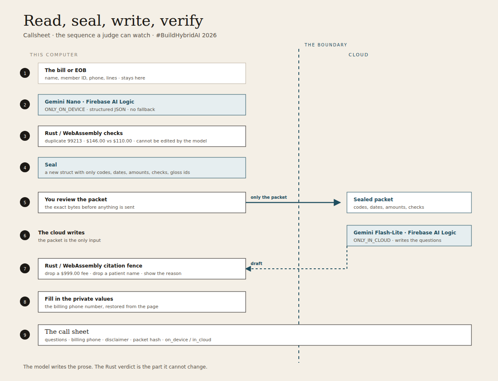
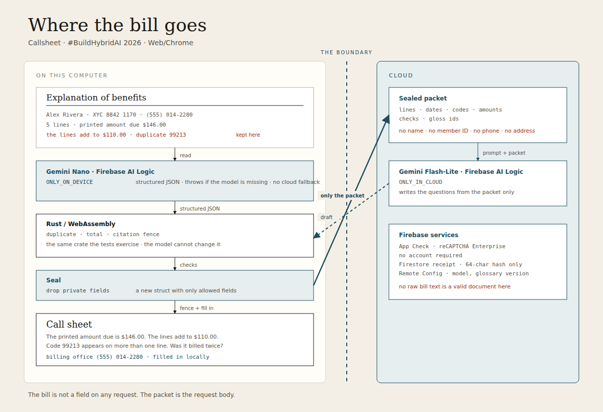

# Callsheet

**A medical bill, read on your own computer, turned into the call you should make.**

Callsheet reads an explanation of benefits (EOB) or a provider bill in the browser. It extracts
the lines, checks the arithmetic in Rust, and writes a one-page script for the billing office.
The name, member ID, account number, phone number, and address never leave the browser.

Built for **#BuildHybridAI 2026**, Web/Chrome track, using **Firebase AI Logic hybrid inference**.

Repo: **https://github.com/PhiBao/callsheet** · License: Apache-2.0

```
$146.00  printed amount due
$110.00  the lines, added up
 $36.00  the question the sheet asks first
```

The sample bill is synthetic. The arithmetic error is deliberate. The point is that you can check
it yourself in ten seconds.

---

## The problem

People already paste medical bills into chatbots. The advice works often enough that it spreads:
one public post describes a $1,400 reduction, another a hospital bill cut from $195,000 to $33,000.
The same threads carry the warning: a consumer chatbot is not a covered entity, and a bill full of
names, member IDs, and diagnoses is exactly the document you should not hand to a server you do not
control.

The alternatives are also a hand-off. Goodbill reviews and negotiates, but you send the bill and
they take a share of the savings. Dollar For screens for charity care, but you send the bill and
your income. Both are useful. Neither is the ten minutes before the first phone call.

The first useful move on a surprise bill is usually not a negotiation. It is a question: *what is
this line, why is it here twice, and why does the total not match?* Callsheet is built for that
move.

## Who it is for

An adult who has just opened a bill or an EOB on a laptop and is about to paste it into a chatbot.
They are not looking for a diagnosis or a legal opinion. They want to know what to say when they
call the number printed at the top.

## What it does

1. **Reads the document on the computer.** Gemini Nano, through Firebase AI Logic in
   `ONLY_ON_DEVICE` mode, returns a structured JSON read of the bill. If the device cannot run the
   model, the read throws. It does not fall back to the cloud with the document. This is the whole
   safety property.
2. **Checks the arithmetic in Rust.** The same crate that the tests exercise is compiled to
   WebAssembly and runs in the page. It flags a code that appears twice on the same date, a printed
   total that does not match the lines, and a printed column total that does not match its column.
3. **Seals a packet.** Private fields are dropped at the boundary, not filtered later. The packet
   contains dates, codes, descriptions, amounts, the deterministic checks, and the gloss ids the
   cloud may cite.
4. **Shows you the packet before it goes.** The middle column is the exact bytes that are allowed
   to leave. The name, member ID, account number, phone number, and address are shown as kept.
5. **Writes the questions in the cloud.** Gemini Flash-Lite, through Firebase AI Logic in
   `ONLY_IN_CLOUD` mode, sees only the packet. It returns a small set of sentences with optional
   gloss citations.
6. **Fences the draft.** The Rust verifier drops any sentence that contains a dollar amount not in
   the packet, a code not in the packet, a gloss id we did not author, or a private field. The
   dropped sentences are shown, with the reason.
7. **Fills in the phone number locally.** The number is put back into the finished sheet after the
   cloud draft has been verified. It was never in the packet.

The sheet does not say "this charge is fraudulent," "do not pay," or "you should appeal." It writes
questions and a request for the itemized bill and the matching EOB. That is deliberate. A wrong
answer about a bill is expensive, and a model should not be the authority on whether a charge is
valid.

## The 60-second demo

1. The synthetic bill is already on screen. The printed amount due is `$146.00`. The lines add to
   `$110.00`. Two `99213` lines sit on the same date.
2. Press **Read it on this computer**. The status line says what is happening. The first Nano
   session can take twenty seconds; the UI is honest about it.
3. The middle column fills with the sealed packet. The bill's name and member ID are struck out on
   the kept side.
4. Press **Write the questions**. The cloud sees only the packet.
5. The call sheet appears. The first question is the `$36.00` difference. The second is the
   duplicate visit. The billing phone number appears at the bottom, filled in locally.
6. The proof strip shows the packet hash, `on_device` for the read, `in_cloud` for the write, the
   check ids, and the fence result.

A longer demo script, including the deliberate dropped sentence, is in `docs/demo.md`.



## Why hybrid, and why this split

The hybrid SDK is not a fallback gimmick here. It is the only way to make the promise true.

| Step | Where | Why |
| --- | --- | --- |
| Read the bill | On device, `ONLY_ON_DEVICE` | The document is the sensitive object. If the device cannot run the model, the product must stop, not upload. |
| Check the arithmetic | On device, Rust/WASM | A total is a fact. A model should not be able to change it. |
| Write the questions | Cloud, `ONLY_IN_CLOUD` | Nano is a small model. It is good at extraction and poor at writing a calm script. The cloud is good at the prose, and it only needs the packet. |
| Fence the draft | On device, Rust/WASM | The cloud can hallucinate a number. The fence is the last thing between the model and the sheet. |
| Fill in the phone | On device | The number is private, and it is only needed after the draft exists. |

`PREFER_ON_DEVICE` is deliberately not used for the read. A preference mode can fall back to the
cloud when Nano is missing, which is exactly the failure this product exists to prevent.

## What is genuinely new

Three things, none of which is "it uses AI":

1. **The private read cannot fall back.** The inference mode is a hard boundary, not a preference.
2. **The verdict is deterministic and the prose is not.** The model writes the questions, but it
   cannot change the duplicate finding or the total. The sheet is assembled from both.
3. **The fence is visible.** The app shows which sentences were dropped and why. A judge can plant a
   bad number and watch the sheet refuse it.

The domain is also specific. A generic redaction hatch asks *what do you want done with this
document?* Callsheet knows the next call. The glossary is a small, authored set of one-line glosses,
not a copy of the AMA CPT book. If a code is not in the glossary, the sheet says nothing about it.

## Architecture



```
┌────────────────────────────── Browser ──────────────────────────────┐
│  pdf.js / pasted text                                               │
│        │                                                            │
│        ▼                                                            │
│  Firebase AI Logic  ONLY_ON_DEVICE  ──►  structured bill JSON       │
│        │                                      │                     │
│        │                                      ▼                     │
│        │                              Rust/WASM checks              │
│        │                                      │                     │
│        │                                      ▼                     │
│        │                              sealed packet (no PII)        │
│        │                                      │                     │
│        ▼                                      ▼                     │
│  Firebase AI Logic  ONLY_IN_CLOUD  ◄──  user reviews the packet     │
│        │                                                            │
│        ▼                                                            │
│  Rust/WASM citation fence  ──►  kept sentences + dropped reasons    │
│        │                                                            │
│        ▼                                                            │
│  local fill-in (name, phone)  ──►  call sheet                        │
└─────────────────────────────────────────────────────────────────────┘
        │                    │                         │
        ▼                    ▼                         ▼
   App Check           Firestore receipt         Remote Config
   reCAPTCHA           public, append-only       model name,
                       hash + sources +         glossary version
                       counts, no raw text
```

The bill is not a field on any request. The packet is the only request body. The Rust verifier
re-checks the cloud draft in the page, and the same crate can be exposed by a small Axum process
for an independent `POST /verify` proof. The optional server is not in the inference path.

Diagrams:

- `docs/diagrams/where-the-bill-goes.svg` — the boundary, for a judge in a hurry.
- `docs/diagrams/read-seal-write-verify.svg` — the sequence, with the packet as the only crossing.

## Data model

`Extraction` (private, stays in the page):

```
private: { patient_name, member_id, account_number, provider_name, provider_phone, service_address }
lines:   [{ line, date, code, description, billed_cents, allowed_cents, plan_paid_cents, patient_cents }]
printed_amount_due_cents, printed_total_billed_cents, printed_total_patient_cents
```

`SealedPacket` (the only thing the cloud sees):

```
lines:   [{ date, code, description, billed_cents, allowed_cents, plan_paid_cents, patient_cents }]
printed_amount_due_cents, printed_total_billed_cents, printed_total_patient_cents
checks:  [{ id, severity, message, line_numbers, numbers_cents }]
glossary:[{ code, gloss_id }]
```

`Verdict`:

```
{ ok, accepted: [{ text, citation }], dropped: [{ text, reason }] }
```

## What is real, what is captured, what is absent

| Claim | State |
| --- | --- |
| On-device structured read through Firebase AI Logic `ONLY_ON_DEVICE` | Implemented and verified on Chrome stable 149: the model returned a structured read of the sample with the five lines, the `$146.00` amount, and the duplicate `99213`. The UI shows the source from the SDK. |
| Rust duplicate and total checks | Implemented and tested (`cargo test`, 8 tests). Compiled to WASM and used by the page. |
| Citation fence | Implemented and tested. Drops a sentence with a number not in the packet, an unknown code, an unknown gloss id, or a private field. |
| Cloud writing through `ONLY_IN_CLOUD` | Implemented. Needs a Firebase project with AI Logic enabled and App Check configured. |
| Firestore receipt | Implemented. Public, append-only, and stores a SHA-256 packet hash, sources, check ids, and counts. Never the bill. |
| App Check | Code path present. The hosted build uses a reCAPTCHA Enterprise site key; the App Check app registration is a console step. |
| PDF text extraction | `pdf.js` is a should-ship. The reliable demo path is pasted or fixture text. |
| Photo of a bill | Should-ship. The hybrid SDK supports JPEG/PNG on-device. Not required for the core demo. |
| Negotiation, fair-price benchmarks, charity-care eligibility, medical or legal advice | Not built, by design. |
| Android and iOS | Not in the MVP. The rules allow a single platform, and the product's native surface is a browser with a PDF already open. |

## Hackathon relevance

- **Track:** Web/Chrome (eligible for Best Web/Chrome and the Grand Prize).
- **Required technology:** Firebase AI Logic hybrid inference, with App Check. Both inference modes
  are used for a reason, not as a toggle.
- **Judging criteria:** technological implementation (two real modes, `inferenceSource`, structured
  output, a WASM fence), design (a document, a boundary, a sheet), potential impact (a checkable
  arithmetic error on a document people already paste into chatbots), quality of the idea (the
  model writes the prose but cannot change the verdict).
- **Submission:** public Apache-2.0 repo, hosted URL, three-minute video, README, and a real vs
  captured table. See `docs/submission.md`.

## Running it

Prerequisites:

- Node 22+, pnpm 11+
- Rust nightly with `wasm32-unknown-unknown`
- `wasm-pack` 0.13+
- Desktop Chrome 139+ for the on-device model

```bash
# 1. Dependencies
pnpm --dir apps/web install

# 2. The rules engine, compiled to WASM
wasm-pack build crates/callsheet-rules --target web --out-dir ../../apps/web/src/wasm --release

# 3. The Rust tests
cargo test -p callsheet-rules

# 4. The app
pnpm --dir apps/web dev
```

Open `http://127.0.0.1:5173`.

Without Firebase configuration, the app runs in **local development mode**: the read uses the raw
Chrome Prompt API, and the write uses the template questions. That mode is labeled in the UI. It is
not the submission path. The hosted build uses Firebase AI Logic.

### Firebase setup

The full walkthrough is in `docs/firebase-setup.md`. The short version:

1. Create a Firebase project and a web app.
2. Enable **AI Logic** and choose the Gemini Developer API (free tier).
3. Enable **App Check** with reCAPTCHA Enterprise for the web app. Register the app in the console
   and enforce App Check for AI Logic.
4. (Optional) Enable **Anonymous** authentication. The receipt does not require an account.
5. Create a Firestore database and deploy `firestore.rules`.
6. Copy `apps/web/.env.example` to `apps/web/.env.local` and fill in
   `VITE_FIREBASE_CONFIG` and `VITE_APP_CHECK_SITE_KEY`.
7. `pnpm --dir apps/web build`
8. `firebase deploy --only hosting,firestore:rules`

The cloud model is `gemini-3.5-flash-lite`. It is a free-tier text model. No image generation, no
speech, no quota account.

## Tests

```bash
cargo test -p callsheet-rules
```

The Rust tests cover:

- duplicate `99213` on the same date is flagged
- the printed `$146.00` against the `$110.00` line sum produces a `$36.00` check
- sealing drops the patient name, member id, and phone number
- a sentence with a `$999.00` amount not in the packet is dropped
- a sentence that names the patient is dropped
- an unknown gloss citation is dropped
- a valid citation is accepted

The browser test plan and the demo fixtures are in `docs/demo.md`.

## Security and reliability

- **No private field in the packet.** The seal function constructs a new struct with only the
  allowed fields. There is no "filter later" path.
- **No cloud fallback for the read.** `ONLY_ON_DEVICE` throws when the model is unavailable. The UI
  shows the error and keeps the document in the page.
- **No raw bill in Firestore.** The rules accept only a 64-character hash, two source strings, a
  bounded list of check ids, and counts.
- **No production secrets in the repo.** `.env.local` is ignored. App Check debug tokens are local
  only.
- **CSP and hosting headers** in `firebase.json`: no third-party scripts, no framing, no referrer.
- **The fence is adversarial.** It is tested with a planted bad number and a planted patient name.
- **The model is not the authority.** It cannot change a check, and it cannot add a number.

Known failure modes:

- Chrome without the model: the read throws. The app explains and does not upload.
- Cloud unavailable: the packet and checks remain visible; the template questions can still be
  used. The sheet does not pretend a cloud call happened.
- A bill the model reads badly: the user can see the extracted lines before the packet is sent. The
  manual correction path is on the roadmap.
- A code not in the glossary: the sheet abstains. It does not invent a meaning.

## Limitations

- The glossary is four authored codes for the synthetic demo. It is not a CPT database. CPT
  descriptions are licensed by the AMA; this project does not copy them.
- The sample is US-shaped. The product thesis (a private read, a deterministic check, a public
  explanation, a local fill-in) generalizes; the first document type does not.
- The on-device model is slow to start and has a small context. The product is one careful read of
  one page, not a chat.
- No negotiation, no fair-price benchmark, no charity-care determination. Those are deliberate
  non-goals, not missing features.
- The hosted demo requires a Firebase project and App Check. The local development mode is not the
  submission path.

## Roadmap

1. A manual correction step before the packet is sealed, so a bad extraction never becomes a bad
   question.
2. A second document type: an insurance denial letter, with the same deterministic checks and a
   different public corpus.
3. A PDF text path with `pdf.js`, then a photo path with the on-device multimodal model.
4. A downloadable sheet and a follow-up reminder.
5. An Android client only if a supported device and the on-device model are available. The web
   client remains the reference.

## License

Apache-2.0. See `LICENSE`.

The sample bill, the glossary glosses, and the diagrams are original work for this project. The
product is a reading aid, not medical, legal, or financial advice.
